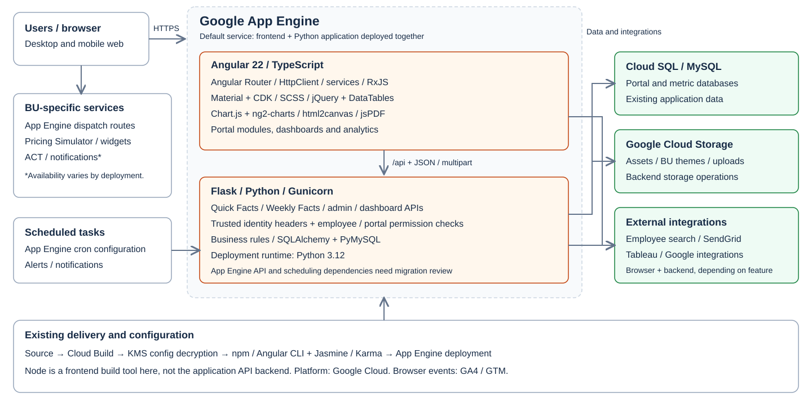
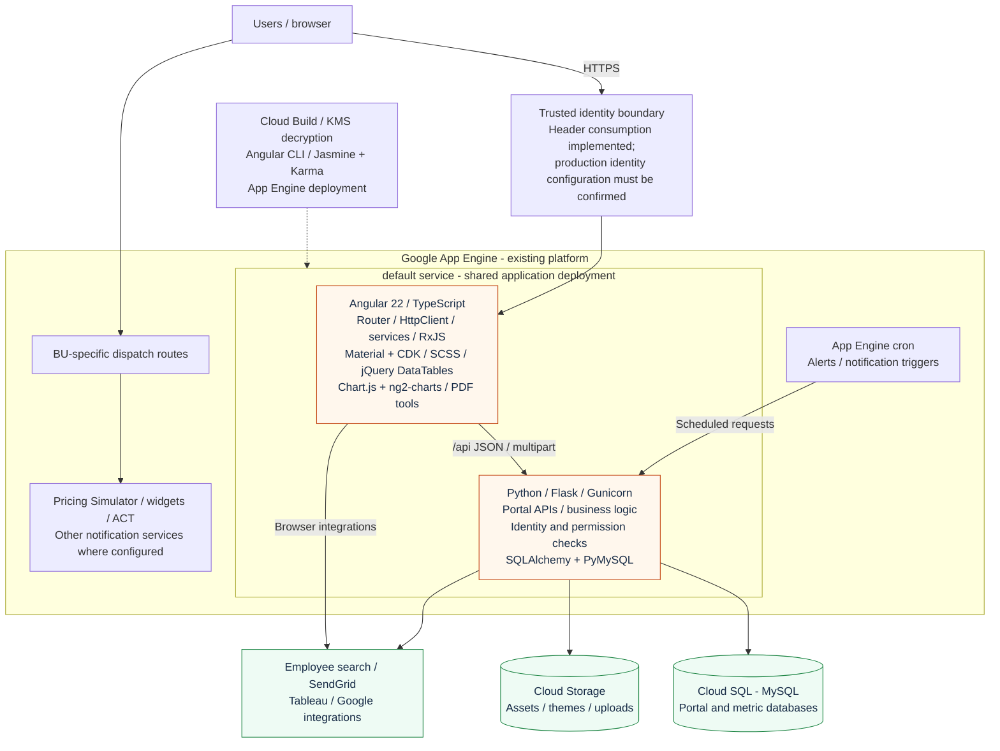
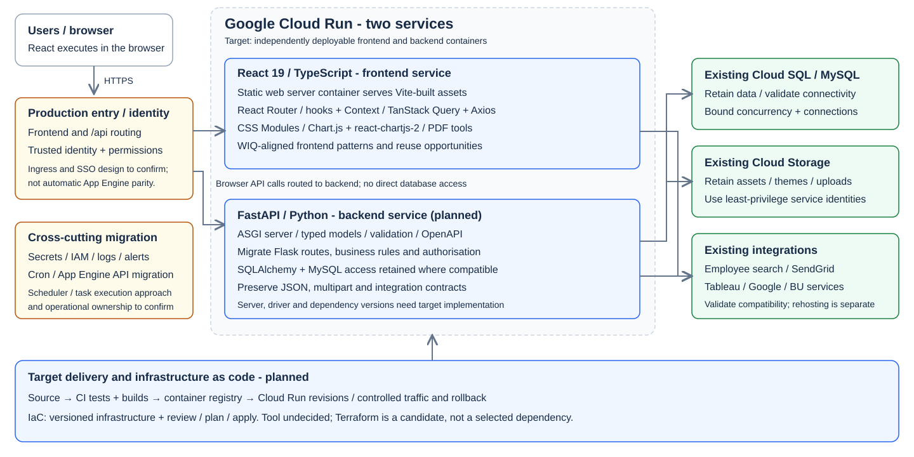
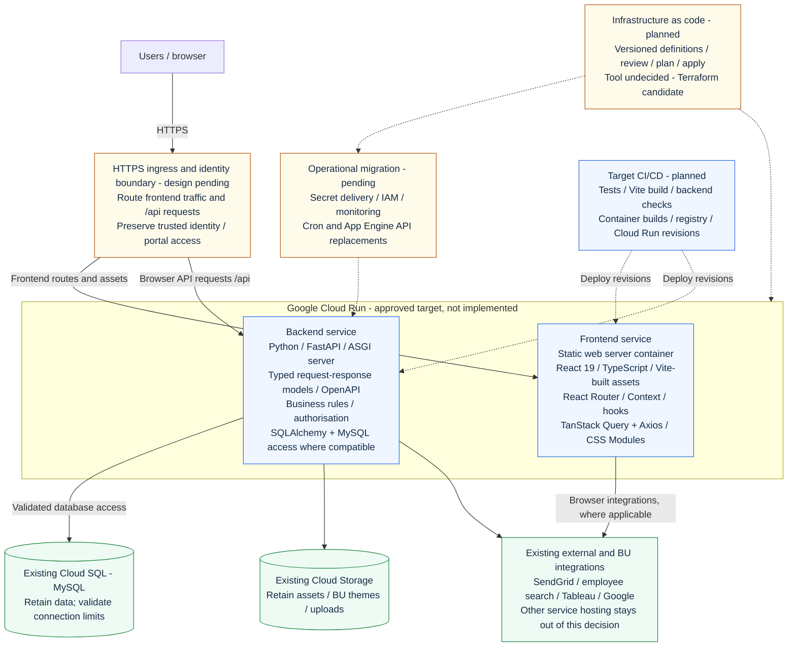

# Store Insights: OLD and NEW architecture

**Audience:** WIQ engineering management and delivery teams.  
**Prepared:** 26 October 2026.  
**Decision:** migrate Angular to React, Flask APIs to FastAPI, and App Engine hosting
to separate frontend/backend Cloud Run services. Introduce infrastructure as code;
the tool is **undecided**. Terraform is a candidate, not an approved selection.

## Presentation and diagrams

- [Five-page presentation](architecture-presentation.html): open locally in a browser.
- [Presentation PDF](architecture-presentation.pdf): share or present without browser tooling.
- [OLD architecture SVG](old-angular.svg): editable vector diagram for slides.
- [NEW target architecture SVG](new-react-fastapi.svg): editable vector diagram for slides.
- Editable Mermaid definitions are included below; GitHub renders these in Markdown.

The HTML uses only local files: no remote fonts, diagram renderer or analytics.
Keep the HTML and both SVGs in the same directory. To regenerate the PDF, open
the HTML, choose **Print / Save PDF**, and save using the supplied landscape page
size, background graphics enabled, and browser headers/footers disabled.

## Executive message

**Align Store Insights with WIQ's React ecosystem while modernising the API and
deployment layers.** Most WIQ projects already use React (team context supplied by
the project owner). Using the same frontend technology improves opportunities for
cross-project contribution, shared components, common tooling and operational
support. FastAPI introduces typed API contracts; Cloud Run introduces independently
deployable containers; infrastructure as code makes platform changes reviewable.

This is not a claim that Angular is obsolete or that React is always faster.
The inspected Angular manifest declares Angular 22. Benefits come from alignment,
architecture and engineering practices, not simply replacing a framework name.

## Current implementation versus target

| View | Meaning |
|---|---|
| OLD | Existing Angular/Flask application and checked-in App Engine configuration. |
| Current React repository | React frontend implemented in part; still calls the existing Python/Flask backend. Its checked-in deployment builds static assets and deploys App Engine service `ip-react`. |
| NEW | Approved **target design**, not an already-deployed stack: React frontend and FastAPI backend in separate Cloud Run services, managed using an undecided IaC tool. |

The FastAPI backend, Cloud Run service definitions, container build/release
pipeline and IaC implementation are not present in the inspected React repository.
Several non-Quick-Facts frontend routes still render `ComingSoon`, and
`AuthContext.tsx` still supplies a demo user. Do not present the new stack as
production-ready or the whole portal as fully migrated.

## OLD: Angular + Flask + App Engine

### Runtime and request flow

1. App Engine serves the Angular static build and the Flask application through the
   existing application deployment. `app.yaml` declares Python 3.12 and Gunicorn.
2. Angular uses HttpClient and RxJS-based services to call JSON/multipart endpoints.
   Flask applies employee/portal checks and accesses SQLAlchemy/PyMySQL databases.
3. Existing identity code consumes trusted user headers, including
   `X-Goog-Authenticated-User-Email`. The exact deployed identity/IAP configuration
   is outside the inspected source; this document does not assert its configuration.
4. Backend functions use Cloud Storage, SendGrid and employee search. Dashboard and
   Google integrations span browser and server code.
5. BU-specific dispatch configurations route some requests to separate services.
   App Engine cron also triggers data checks/notifications.
6. The current Cloud Build pipeline decrypts BU configuration using KMS, builds and
   tests Angular, then deploys App Engine. Node runs build tools, not the API server.

This is an application/platform architecture, not a complete enterprise data
lineage diagram. Warehouse ingestion, upstream metric pipelines, network topology
and live resource inventories were not established from these repositories.

## NEW: React + FastAPI + Cloud Run + IaC

### Target request flow and boundaries

1. Users reach an approved HTTPS/identity entry point. The ingress implementation is
   not selected: a load balancer, gateway or alternative routing solution must be
   evaluated rather than assumed to exist. Prefer a same-origin `/api` contract to
   minimise frontend endpoint changes; validate identity, cookies and CSRF handling.
   Separate origins would require explicit CORS and session/token design.
2. The frontend Cloud Run service serves static React assets from a web-server
   container. React executes in the browser; it does not execute in Cloud Run.
   The static server implementation is not selected. Node remains a build tool;
   neither Express nor a Node API is being introduced by this design.
3. Browser API calls reach the separate FastAPI Cloud Run service. Preserve
   endpoint paths, methods, query parameters, JSON shapes, multipart uploads,
   downloads and error behaviour, unless a deliberately versioned contract is approved.
4. Flask's framework-specific routing, request context, decorators, sessions and
   error handling must be migrated. Existing business rules and Python data-access
   code can be retained where compatible. FastAPI uses typed models/Pydantic and
   an ASGI server; exact versions and server configuration remain implementation decisions.
5. Keep existing Cloud SQL data, Cloud Storage assets and integration contracts.
   Validate Cloud Run connectivity, IAM, egress and outbound API credentials.
   Retaining data services does not mean their connection configuration is unchanged.
6. Set Cloud Run concurrency, maximum instances and database pool limits together.
   FastAPI async handlers do not make blocking PyMySQL operations non-blocking;
   use a suitable sync execution model or explicitly select an async database stack.
7. Manage platform definitions through reviewed IaC. Agree the tool, ownership,
   state storage/locking, environment boundaries and secret handling before rollout.
   Do not migrate all ancillary services implicitly: their hosting decisions and
   feature/integration parity require separate validation.

## Technology changes and benefits

| Layer | OLD | NEW target | Benefit and qualification |
|---|---|---|---|
| Frontend framework | Angular 22 / TypeScript | React 19 / TypeScript | Aligns with most WIQ frontends; enables reuse of skills and compatible components. TypeScript is retained, not newly introduced. |
| Navigation and UI state | Angular Router / injected services / RxJS | React Router / hooks / Context | Familiar patterns across React projects; requires team conventions to avoid divergence. |
| API client and server state | HttpClient / service-managed streams | Axios / TanStack Query | Explicit query caching, invalidation and request lifecycle; tune freshness for business data. |
| UI components and styling | Material/CDK / SCSS / jQuery DataTables | React components / CSS Modules / native React-rendered tables in current scope | Opportunity to reduce Angular/jQuery dependencies and share WIQ UI. Angular already supports component style encapsulation; CSS isolation is not a React-only benefit. Complex table and accessibility parity still need verification. |
| Visualisation and exports | Chart.js / ng2-charts / html2canvas / jsPDF | Chart.js / react-chartjs-2 / html2canvas-pro / jsPDF | Retains chart/export concepts and investment; wrapper changes, not a wholesale visualisation redesign. |
| API framework | Flask / Python | FastAPI / Python / typed models | Validation, OpenAPI contracts and generated client possibilities. Different default validation/status behaviour must be reconciled with existing clients. |
| Hosting | App Engine application + dispatch | Separate Cloud Run frontend/backend containers | Clear release boundaries, container portability and configurable scaling. App Engine already offers managed deployment/scaling; those capabilities are not wholly new. |
| Infrastructure management | Checked-in app/dispatch/cron YAML + Cloud Build deployment | Versioned IaC, tool undecided | More comprehensive resource definitions, reviewable changes and environment reproducibility. Existing deployment configuration is already versioned; IaC extends that practice. |
| Delivery | Angular CLI build/tests + App Engine deploy | Proposed container CI/CD + Cloud Run revisions | Independent service releases and controlled rollout/rollback. Image registry and pipeline changes still need implementation. |
| Frontend tests | Jasmine / Karma / browser-based unit tests | Vitest / Testing Library | Component-focused testing and shared React tooling; not a substitute for browser E2E or API contract tests. |
| Data and integrations | MySQL / Cloud Storage / SendGrid / employee / dashboards | Retain, validate and reconnect | Avoids coupling the migration to a database rewrite; preserves existing business integrations. |
| Identity and security | Existing header-based identity and portal checks | Equivalent controls designed for Cloud Run | Preserves access requirements; stronger security is not automatic from a framework change. |
| Google Cloud | App Engine / Cloud SQL / Storage / KMS / build tooling | Cloud Run with retained compatible services | Platform continuity while changing compute and deployment model. |

## WIQ-specific business case

**Primary rationale: team alignment.** Most WIQ projects use React, as supplied by
the project owner. Other WIQ repositories were not inspected, so common library
versions, design systems and infrastructure tools are opportunities to confirm,
not existing integrations claimed by this document.

| Opportunity | Why it matters for WIQ | Prerequisite / evidence of success |
|---|---|---|
| Developer mobility | More teammates can contribute to Store Insights using the frontend framework they already use. | Agree React/TypeScript conventions; compare onboarding time and cross-project contributors. |
| Shared UI investment | Filters, metric cards, layouts, accessible dialogs and export flows may be reusable across compatible React apps. | Identify the actual WIQ design system/component library; track adopted components rather than assume reuse. |
| Common tooling | Similar testing, linting, build and API patterns reduce context switching. | Align versions/toolchain with WIQ standards; track duplicate tooling and maintenance work. |
| Cross-project support | Broader React familiarity can reduce dependence on a small application-specific frontend group. | Shared runbooks, paired onboarding and ownership; measure review/support participation. |
| Faster delivery | Reused patterns and typed API contracts can reduce reimplementation and integration ambiguity. | Measure lead time, escaped contract defects and rework before/after migration. |
| More repeatable operations | Containers and reviewed IaC can reduce manual environment differences and enable controlled releases. | Implement automated checks, IaC state controls and rollback drills; measure deployment failure/recovery. |

### Benefits that should not be promised without measurement

- **Performance:** no claim that React or FastAPI alone makes the application faster.
  Benchmark representative routes, dashboard loads, exports, p95 API latency and
  concurrent access with equivalent data and environments.
- **Cloud cost:** no guaranteed savings. Cloud Run minimum instances, CPU/memory,
  cold-start policy, load balancing, registry, networking and Cloud SQL determine cost.
  App Engine already supplies managed scaling.
- **Security:** typed validation helps input contracts but does not replace identity,
  authorisation, dependency maintenance, CSRF controls or trusted ingress.
- **Reuse:** React alignment makes reuse possible, not automatic; compatible
  design systems, licensing, package interfaces and ownership are still necessary.
- **Migration effort:** include training, dual-running, feature parity, database
  connectivity changes and operational migration in the business case.

## Readiness gates and unresolved decisions

| Gate | Required before cutover |
|---|---|
| Complete portal scope | Inventory Angular modules and integrations beyond Quick Facts; remove or explicitly scope remaining `ComingSoon` routes. |
| Identity and access | Replace React demo identity; implement verified trusted identity and backend portal/role checks on Cloud Run. Do not trust user-supplied identity headers. |
| API compatibility | Add regression/contract tests for routes, trailing slashes, status/error responses, uploads, PDFs, recognition, feedback and existing external consumers. |
| Ingress and traffic | Choose production routing, domains, cookies/CORS/CSRF and API origin. Test deep-link SPA fallback. Existing App Engine dispatch is not a Cloud Run routing solution. |
| Data and dependencies | Prove SQL access, connection limits, storage permissions, employee search, email, dashboards and Google integrations. Keep credentials server-side. |
| Platform-specific functions | Inventory App Engine APIs, cron and helper services; choose scheduler and task replacements or an explicit coexistence arrangement. Check local filesystem assumptions for Cloud Run. |
| Infrastructure ownership | Select IaC tool; agree state/locking, environment promotion, approvals, IAM, secret delivery and existing-resource import/ownership. |
| CI/CD quality gates | Test React and FastAPI, build/scanning of containers, publish to an approved registry, deploy revisions and exercise rollback. Current React Cloud Build runs build/type checks but no explicit `vitest` step. |
| Operational readiness | Configure logs, metrics, alerts, service accounts, runtime secrets, concurrency/instance limits and cost monitoring. Keep long-running tasks outside request lifetimes where required. |
| Safe cutover | Validate business/visual/accessibility parity, compare performance/cost, stage traffic and keep a tested fallback until acceptance. |

The frontend/backend service split is approved for this document. Database and
integration retention is a design assumption approved by the owner, not evidence
that Cloud Run access or every integration is already validated.

## Evidence and traceability

The OLD/current views are based on local checked-out files on 26 October 2026.
The NEW FastAPI/Cloud Run/IaC direction and service split were supplied/approved by
the project owner in this conversation. No cloud account or live infrastructure
inventory was queried. No credentials or decrypted environment files are included.

| Evidence | Supports |
|---|---|
| Angular checkout `store-insights/package.json`, `angular.json` | Angular 22, Material/CDK, RxJS, Chart.js, jQuery/DataTables, CLI builder and Jasmine/Karma. The current Angular builder is `@angular/build:application`; do not describe it as a confirmed legacy webpack-only build. |
| Angular checkout `store-insights/app.yaml`, `requirements.txt` | Python 3.12 deployment declaration; Flask, Gunicorn, SQLAlchemy/PyMySQL, Storage and SendGrid dependencies. |
| Angular checkout `store-insights/backend/main.py`, `common/auth.py`, `common/user_helper.py`, `common/db.py`, `common/utils.py` | Flask module registration, identity/permission enforcement, MySQL connections and storage/email integrations. |
| Angular repository `cloudbuild.yaml`; checkout `cron.yaml`, `dispatchers/` | Existing build/decrypt/deploy pipeline, schedules and BU-specific ancillary service routing. |
| React `../../package.json`, `../../vite.config.ts`, `../../src/main.tsx` | React 19, TypeScript, Vite, Query, Axios, Router and development API proxy. |
| React `../../app.yaml`, `../../cloudbuild.yaml`, `../../dispatch.yaml`, `../../scripts/prebuild.mjs` | Current `ip-react` App Engine deployment and existing API dispatch, BU config build step; these are not Cloud Run definitions. |
| React `../../src/context/AuthContext.tsx`, `../../src/App.tsx` | Demo authentication and remaining placeholder routes. |
| React `../../src/utils/gcpSlides.ts`, `../../src/utils/analytics.ts` | Existing frontend Google export and analytics code. |

Reference revisions: Angular parent repository `02a9cf698`; React `6035014`.
Local files, not only those commit IDs, were inspected; this is not a certificate
that either checkout is an exact image of a production deployment.
